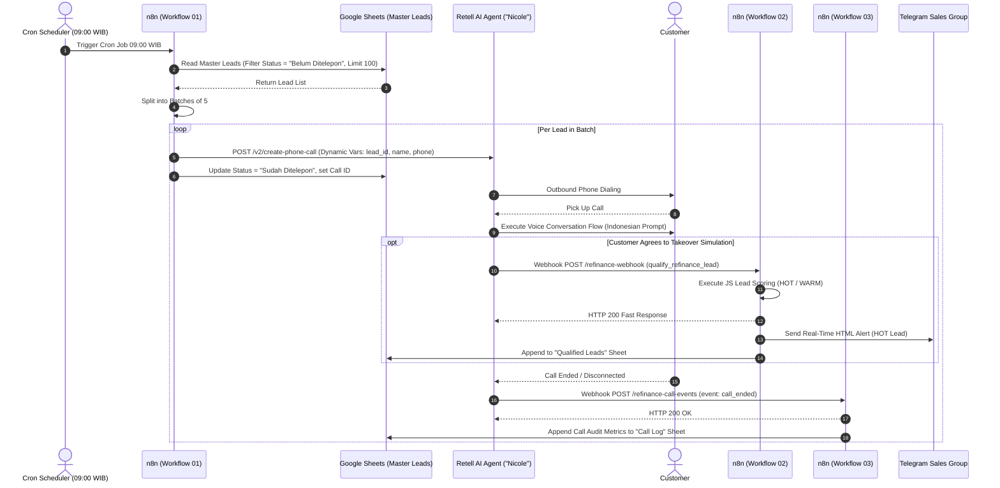
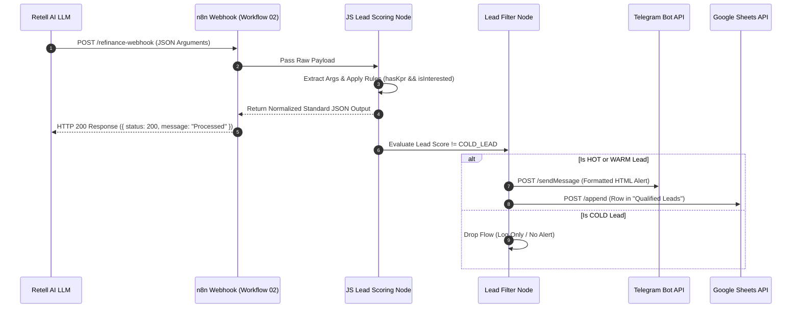
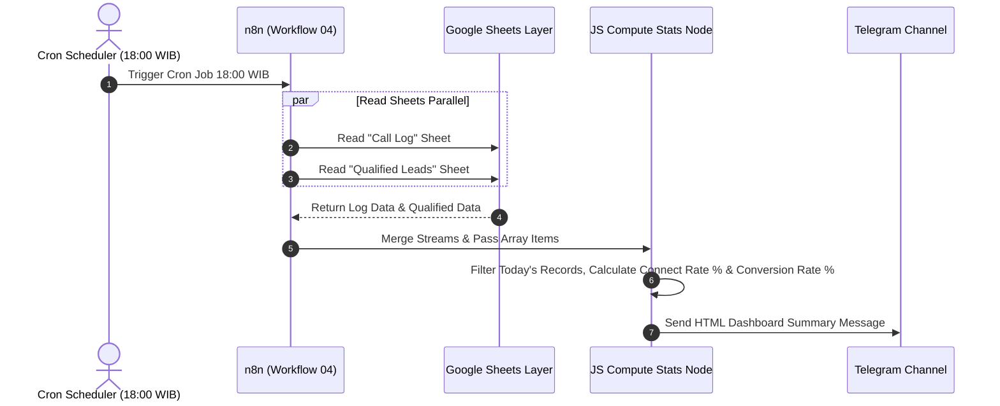

# TECHNICAL INTERVIEW GUIDE & SYSTEM CHEAT SHEET
## 99 Group Automated Refinancing Call System (AI Voice & Orchestration)

> [!NOTE]
> **Context Assessment:** Project ini dibangun dalam kurun waktu **48 Jam** untuk **99 Group Graduate Program AI Assessment Challenge**. Seluruh evaluasi teknis, analisis arsitektur, trade-off, dan roadmap pengembangan dalam panduan ini disesuaikan dengan skala waktu 48 jam tersebut.

---

## 1. Project Overview

### Tujuan Project
Membangun sistem *outreach* berbasis suara (*voice AI*) otomatis yang mampu melakukan panggilan dingin/hangat (*outbound calling*) ke 100 calon nasabah KPR per hari untuk menawarkan program refinancing/takeover KPR (penurunan suku bunga 2–3% dan penghematan cicilan bulanan).

### Masalah yang Diselesaikan
1. **High Telemarketing Cost & Friction:** Menghubungi ratusan leads secara manual membutuhkan banyak agen telemarketing manusia dengan biaya tinggi dan tingkat kejenuhan tinggi.
2. **Slow Lead Qualification:** Banyak waktu terbuang untuk menyaring leads yang tidak memiliki KPR aktif atau tidak berminat.
3. **Manual Data Entry & Delayed Follow-up:** Pencatatan hasil telepon manual berpotensi salah (human error) dan memperlambat waktu respon ke *qualified leads*.

### Target User
*   **Target Penerima Telepon (End User):** Pemilik rumah / nasabah yang memiliki KPR aktif di bank Indonesia.
*   **Internal User (Sales/Mortgage Specialist Team):** Tim Sales/Telemarketing Rumah123 (99 Group Indonesia) yang menerima *real-time alert* nasabah *qualified* (HOT leads) via Telegram.
*   **Management / Operations:** Menerima laporan ringkasan KPI harian otomatis pada pukul 18:00 WIB.

### Scope Project (48 Hours Challenge)
*   **Voice AI Agent ("Nicole"):** Percakapan interaktif natural dalam Bahasa Indonesia dengan dynamic variable extraction dan tool calling.
*   **Automation Engine (n8n Workflows):**
    1. Outbound caller scheduler (Cron 09:00 WIB, throttling batch of 5, limit 100/day).
    2. Lead qualification & scoring pipeline (HOT / WARM / COLD).
    3. Real-time Telegram alert & Google Sheets persistence.
    4. Call event lifecycle logger (`call_ended`, `call_analyzed`).
    5. Daily KPI reporting scheduler (Cron 18:00 WIB).
    6. Global error notification fallback system.
*   **Data Persistence Layer:** Google Sheets (`Master Leads`, `Qualified Leads`, `Call Log`).

### High-Level Architecture
```
┌─────────────────────────────────────────────────────────────────────────────┐
│                           GOOGLE SHEETS (Data Layer)                        │
│  ┌──────────────┐  ┌────────────────┐  ┌────────────────┐                   │
│  │ Master Leads │  │ Qualified Leads│  │   Call Log     │                   │
│  │  (Source)    │  │  (Hot/Warm)    │  │ (All Events)   │                   │
│  └──────┬───────┘  └───────┬────────┘  └───────┬────────┘                   │
└───────┬─┼──────────────────┼───────────────────┼──────────────────────────┘
        │ │                  │                   │
        │ │                  │                   │
┌───────▼─▼──────────────────▼───────────────────▼──────────────────────────┐
│                              n8n (Orchestration Layer)                       │
│                                                                             │
│   ┌─────────────────────┐    ┌─────────────────────┐    ┌──────────────┐   │
│   │ 01 Daily Outbound   │───▶│ 02 Pipeline         │    │ 03 Events    │   │
│   │    Caller (09:00)   │    │    Production       │    │    Logger    │   │
│   └─────────────────────┘    └─────────────────────┘    └──────────────┘   │
│                                                                             │
│   ┌─────────────────────┐    ┌─────────────────────┐                       │
│   │ 04 Daily Summary    │    │ 05 Error Notifier   │                       │
│   │    Report (18:00)   │    │  (Global Safety Net)│                       │
│   └─────────────────────┘    └─────────────────────┘                       │
└─────────────────────────────────────────────────────────────────────────────┘
        │                                  ▲
        │ HTTP Request (Outbound Call)     │ Custom Webhooks
        ▼                                  │ (tool call & events)
┌──────────────────────────────────────────┴──────────────────────────────────┐
│                         Retell AI (Voice Layer)                             │
│   • "Nicole" (Senior Mortgage Specialist)                                   │
│   • Model: GPT-4.1 Cascading | Voice: retell-Chloe (Indonesian Accent)      │
│   • Custom Tool: qualify_refinance_lead                                     │
└─────────────────────────────────────────────────────────────────────────────┘
        │
        │ Real-time Alerts / Daily Reports
        ▼
┌─────────────────────────────────────────────────────────────────────────────┐
│                      TELEGRAM (Notification Layer)                          │
└─────────────────────────────────────────────────────────────────────────────┘
```

---

## 2. Tech Stack

| Layer | Technology / Tool | Alasan Pemilihan & Context 48h |
|---|---|---|
| **Voice AI Platform** | **Retell AI** | Platform Voice AI terdepan dengan latensi ultra-rendah (<800ms), mendukung native conversation flow, custom tool calling (webhooks), serta manajemen state/variable yang solid. |
| **LLM Engine** | **GPT-4.1 (Cascading)** | Latensi rendah dengan kapabilitas *reasoning* dan *tool calling* Bahasa Indonesia yang sangat akurat. Cascading mode menjamin ketersediaan fallback jika model utama mengalami gangguan. |
| **Post-Call Analysis** | **GPT-4o-mini** | Model ultra-ringkas dan efisien untuk analisis transkrip pasca-panggilan (sentiment & summary) dengan biaya minimal. |
| **Voice Synthesizer** | **retell-Chloe (TTS)** | Suara wanita profesional, hangat, ramah, dan sangat natural untuk konteks percakapan Bahasa Indonesia. |
| **Workflow Engine** | **n8n (Cloud)** | Orchestration tool low-code/node-based yang sangat cepat untuk memproses webhook, manipulasi data via JavaScript, eksekusi cron job, dan integrasi API tanpa perlu membangun server Express/FastAPI dari awal. |
| **Storage / DB** | **Google Sheets API** | Solusi penyimpanan data visual tanpa setup (zero-infrastructure cost) yang memudahkan pemangku kepentingan (non-tech) langsung meninjau data leads dan audit log. |
| **Notification / Alerting** | **Telegram Bot API** | Kanal komunikasi instan gratis, fleksibel (dukungan formatting HTML), dan memiliki delivery rate 100% untuk mendistribusikan HOT leads dan alert kegagalan sistem. |

---

## 3. Folder Structure

```
.
├── ARCHITECTURE.md                                 # Dokumentasi arsitektur sistem, skema data, & aliran data detail
├── PROMPTS.md                                      # Dokumentasi prompt engineering, konfigurasi agent, & evaluasi LLM
├── README.md                                       # Overview project & petunjuk peninjauan assessment
├── data/
│   └── sample-master-leads.csv                     # Dummy data 8 nasabah KPR untuk keperluan testing batch & format CSV
├── n8n/
│   ├── 01-n8n-daily-outbound-caller.json           # Workflow #1: Cron 09:00 WIB, Batching, Filtering, & DRY RUN Caller
│   ├── 02-n8n-refinancing-pipeline-production.json # Workflow #2: Webhook receiver tool call, Lead Scoring, Telegram, Sheets
│   ├── 03-n8n-call-events-logger.json              # Workflow #3: Webhook receiver call lifecycle (started/ended/analyzed)
│   ├── 04-n8n-daily-summary-report.json            # Workflow #4: Cron 18:00 WIB, Agregasi KPI harian & Telegram Summary
│   └── 05-n8n-error-notifier.json                  # Workflow #5: Global Error Handler yang menangkap kegagalan workflow lain
└── retell/
    └── retell-voice-agent-nicole-refinance.json    # Full JSON export konfigurasi Voice Agent "Nicole" (Flow, Prompts, Tools)
```

### Hubungan Antar Folder & File:
*   File di folder `retell/` dikonfigurasikan di platform Retell AI. Tool `qualify_refinance_lead` pada Retell menembak Webhook URL yang disediakan oleh Workflow `02` di folder `n8n/`. Event lifecycle Retell menembak Webhook URL di Workflow `03`.
*   Workflow `01` di `n8n/` membaca data dari Google Sheets yang strukturnya sesuai contoh pada `data/sample-master-leads.csv`.
*   Workflow `05` direferensikan dalam `settings.errorWorkflow` di setiap workflow `01`–`04` di `n8n/` sebagai *centralized error listener*.

---

## 4. Application Lifecycle

1. **Scheduled Trigger Phase (09:00 WIB):**
   - Cron trigger pada Workflow `01` aktif setiap hari kerja (Senin–Jumat).
   - n8n menarik seluruh data dari Google Sheets `Master Leads`.
2. **Filtering & Throttling Phase:**
   - Evaluasi kolom `Status`: Hanya mengambil baris berstatus `"Belum Ditelepon"` atau *blank*.
   - Pembatasan kuota max 100 leads per hari (`Limit node`).
   - Pembagian data ke dalam *looping batch* berisi 5 leads per iterasi (`SplitInBatches node`).
3. **Outbound Calling Phase:**
   - Setiap item dalam batch dikirim ke Caller Node.
   - *Assessment Mode:* Node `DRY RUN Caller` memunculkan `fakeCallId` dan menyimulasi panggilan.
   - *Production Mode:* HTTP Request `POST https://api.retellai.com/v2/create-phone-call` mengirimkan data `agent_id`, `to_number`, dan dynamic variables (`customer_name`, `lead_id`, `phone_number`).
   - n8n mengupdate `Master Leads` sheet: `Status` = `"Sudah Ditelepon"`, `Call ID`, dan `Last Called At`.
4. **Voice Agent Execution Phase (Retell AI):**
   - Retell AI melakukan dialing ke nomor target.
   - Telepon tersambung → Agent "Nicole" menjalankan prompt `1_Greeting`.
   - Mengikuti *Conversation Flow Node* untuk kualifikasi KPR, pengumpulan nama (`2b_Ask_Customer_Name`), bank, dan tenor (`3_Ask_Bank_and_Tenure`).
5. **Tool Call Execution Phase (In-Call Webhook):**
   - Jika nasabah setuju dihitung simulasinya, Retell memanggil custom tool `qualify_refinance_lead`.
   - HTTP POST terisi parameter ter-ekstraksi meluncur ke n8n Workflow `02` (`/webhook/refinance-webhook`).
   - Workflow `02` melakukan penskoran lead (HOT/WARM), mengirim pesan instan ke Telegram Sales Group, dan mencatat data ke sheet `Qualified Leads`.
   - Workflow `02` merespon HTTP 200 Fast dalam <500ms agar percakapan suara tidak *lagging*.
6. **Call Lifecycle Event Logging Phase:**
   - Saat telepon ditutup, Retell memanggil webhook di Workflow `03` (`/webhook/refinance-call-events`) dengan event `call_ended`.
   - Workflow `03` menghitung durasi bicara dan mencatat status (`ended`, `no_answer`, `busy`) ke sheet `Call Log`.
7. **Daily KPI Reporting Phase (18:00 WIB):**
   - Cron trigger pada Workflow `04` aktif setiap hari kerja pukul 18:00 WIB.
   - Mengambil data dari `Call Log` dan `Qualified Leads` untuk tanggal hari ini.
   - Menghitung *Connect Rate*, *Conversion Rate*, dan breakdown HOT/WARM/COLD, lalu mempublikasikan laporan ringkasan ke Telegram.

---

## 5. Overall Data Flow

```
[Google Sheets: Master Leads]
       │ (Status == "Belum Ditelepon")
       ▼
[n8n Workflow 01: Outbound Caller] (Batch of 5)
       │ HTTP POST /v2/create-phone-call
       ▼
[Retell AI Voice Engine] ──(Panggilan Telepon Seluler)──▶ [Customer]
       │                                                      │
       │ (Customer menyetujui Takeover)                       │ (Percakapan Suara)
       ▼                                                      ▼
[Tool: qualify_refinance_lead] ◀──────────────────────────────┘
       │
       │ Webhook POST /webhook/refinance-webhook
       ▼
[n8n Workflow 02: Refinancing Pipeline Production]
       ├─▶ JS Normalizer & Lead Scoring (HOT/WARM/COLD)
       ├─▶ Filter (Ignore COLD)
       ├─▶ [Telegram Group] (Instant Alert HOT Lead)
       └─▶ [Google Sheets: Qualified Leads] (Append Row)

[Retell Lifecycle Event: call_ended]
       │
       │ Webhook POST /webhook/refinance-call-events
       ▼
[n8n Workflow 03: Call Events Logger]
       └─▶ [Google Sheets: Call Log] (Append Row: duration, status, cause)

[Cron 18:00 WIB]
       ▼
[n8n Workflow 04: Daily Summary Report]
       ├─▶ Read [Call Log] + Read [Qualified Leads]
       ├─▶ Compute Connect Rate & Conversion Rate %
       └─▶ [Telegram Group] (Publish Daily Summary)
```

---

## 6. Backend Architecture & Components

> **Catatan Serverless & Low-Code:** Backend arsitektur project ini diimplementasikan menggunakan serverless orchestration platform (**n8n**) dengan node JavaScript kustom untuk business logic, validasi, dan transformasi data.

### 1. API Endpoints (Webhooks)
*   `POST /webhook/refinance-webhook` (Workflow 02): Webhook sinkron saat percakapan berlangsung (*tool call*). Memproses argumen dari agent voice dan mengembalikan payload JSON status 200.
*   `POST /webhook/refinance-call-events` (Workflow 03): Webhook asinkron penangkap *lifecycle event* dari Retell (`call_started`, `call_ended`, `call_analyzed`).

### 2. Business Logic & Lead Scoring Engine
Logic penskoran lead dieksekusi di node JavaScript `JS Lead Scoring & Normalizer1` dalam Workflow 02:

```javascript
// Algoritma Penskoran Lead
let leadScore = 'COLD_LEAD';
let nextAction = 'LOG_ONLY';

if (hasKpr && isInterested) {
  leadScore = 'HOT_LEAD';
  nextAction = 'ROUTE_TO_KPR_SPECIALIST_TELEMARKETING';
} else if (hasKpr && !isInterested) {
  leadScore = 'WARM_NURTURE';
  nextAction = 'SEND_EDUCATIONAL_WHATSAPP';
}
```

### 3. Error Handling Mechanism
*   **Workflow-Level Error Catching:** Setiap workflow dikonfigurasikan dengan `errorWorkflow: "p8doLQPpsvgkyliM"` yang mengarah ke Workflow 05 (`99Group_Error_Notifier`).
*   **Global Error Alerting:** Jika ada node yang mengalami kegagalan (misalnya API rate limit, Google Sheets outage), Workflow 05 menangkap nama workflow, node yang gagal, pesan error, dan waktu kejadian, lalu secara otomatis mengirim pesan alert berprioritas tinggi ke Telegram Admin.
*   **Graceful Retell Response:** Workflow 02 selalu mengembalikan respon JSON 200 secara cepat ke Retell AI untuk mencegah *call interruption* atau *timeout* pada agent suara.

### 4. Validation & Normalization
*   **Args Extraction Handling (`args_at_root`):** Retell mengirimkan argumen tool secara langsung di root body. Kode JavaScript n8n memiliki mekanisme penanganan defensif untuk mengekstrak parameter dari `payload.args`, `payload.parameters`, `payload.call.custom_variables`, atau `payload` langsung.
*   **String Trimming & Fallbacks:** Nama nasabah dibersihkan dari whitespace. Jika nama tidak diucapkan, fallback diberikan ke `"Nasabah (nama tidak tercatat)"` untuk mencegah *null pointer exception* di sistem downstream.

### 5. Logging System
Sistem menerapkan **Two-Tier Logging Strategy**:
1.  **Business Log (`Qualified Leads`):** Mencatat *high-value business outcome* (nasabah yang qualified beserta atribut KPR dan penskoran).
2.  **System/Audit Log (`Call Log`):** Mencatat setiap aktivitas panggilan telekomunikasi (termasuk panggilan yang tidak diangkat, voicemail, atau durasi 0 detik) untuk keperluan audit teknis dan perhitungan KPI.

---

## 7. Frontend Architecture (N/A)

Project ini difokuskan pada backend automation, voice AI orchestration, dan pemberitahuan operational via Telegram. Interface untuk admin/user dimanifestasikan melalui **Telegram Interface** (bot notification) dan **Google Sheets Dashboard UI**.

---

## 8. Authentication Flow

```
┌───────────┐         ┌──────────────────────────────┐         ┌───────────┐
│ Retell AI │────────▶│ n8n Webhook Endpoint         │────────▶│ Execution │
└───────────┘         └──────────────────────────────┘         └───────────┘
                       • Signature Check disabled
                         in Assessment Code
                       • Production Check:
                         HMAC-SHA256(body, Secret)
```

1.  **External Webhook Security:** Retell AI secara bawaan mengirimkan signature HMAC-SHA256 pada header HTTP webhook.
2.  **Assessment Trade-off:** Pada file `02-n8n-refinancing-pipeline-production.json` dan `03-n8n-call-events-logger.json`, node `Verify Retell Signature` dikonfigurasikan dalam mode bypass:
    ```javascript
    // SIGNATURE VERIFICATION DINONAKTIFKAN UNTUK ASSESSMENT.
    // Retell Web Call tetap mengirim header signature, tapi verifikasinya
    // gagal (key mismatch / bukan API key ber-badge "webhook").
    return [{ json: { ...item, body: parsedBody, signatureCheck: 'DISABLED_FOR_ASSESSMENT' } }];
    ```
    *Reasoning:* Mencegah kegagalan pengujian evaluasi akibat masalah kredensial sandbox web call.
3.  **Google & Telegram Auth:** Menggunakan OAuth 2.0 untuk Google Sheets API dan Bot Token Authentication untuk Telegram API yang tersimpan aman pada Credentials Store n8n.

---

## 9. Database Flow

Sistem memanfaatkan Google Sheets sebagai *relational-like database* dengan 3 tabel (sheets):

```
┌─────────────────────────────────────────────────────────────────────────────┐
│ MASTER LEADS SHEET                                                          │
│ [Lead ID (PK)] | Nama | No HP | Status | Last Called At | Call ID           │
└──────┬──────────────────────────────────────────────────────┬───────────────┘
       │ Read (Where Status == "Belum Ditelepon")             │ Update Status & Call ID
       ▼                                                      │
[Outbound Caller] ───(Trigger Voice Call)                     │
       │                                                      │
       ├──────────────────────────────────────────────────────┘
       │ (Webhook qualify_refinance_lead)
       ▼
┌─────────────────────────────────────────────────────────────────────────────┐
│ QUALIFIED LEADS SHEET                                                       │
│ Customer Name | Has Active KPR | Current Bank | Tenure Years | Interested   │
│ Takeover | Lead Score | Next Action | Processed At | Lead ID (FK) | No HP    │
└─────────────────────────────────────────────────────────────────────────────┘

[Retell Event: call_ended]
       ▼
┌─────────────────────────────────────────────────────────────────────────────┐
│ CALL LOG SHEET                                                              │
│ Call ID (PK) | Lead ID (FK) | Phone Number | Call Status | Disconnection     │
│ Reason | Duration (s) | Started At | Ended At                               │
└─────────────────────────────────────────────────────────────────────────────┘
```

---

## 10. API Flow

### Outbound Call API (`Retell POST /v2/create-phone-call`)
*   **Request Payload (Production Ready):**
    ```json
    {
      "agent_id": "agent_855ac13a806d",
      "to_number": "6281318913092",
      "retell_llm_dynamic_variables": {
        "customer_name": "Gerrio",
        "lead_id": "LEAD-001",
        "phone_number": "6281318913092"
      }
    }
    ```

### Tool Call Webhook (`POST /webhook/refinance-webhook`)
*   **Incoming Payload dari Retell AI:**
    ```json
    {
      "customer_name": "Gerrio Irfan",
      "has_existing_kpr": true,
      "current_bank": "BCA",
      "kpr_tenure_years": 5,
      "interest_in_takeover": true,
      "lead_id": "LEAD-001",
      "phone_number": "6281318913092"
    }
    ```
*   **Response Payload ke Retell AI:**
    ```json
    {
      "status": 200,
      "message": "Lead data successfully processed by 99 Group Engine",
      "data": {
        "leadId": "LEAD-001",
        "phoneNumber": "6281318913092",
        "customerName": "Gerrio Irfan",
        "hasActiveKPR": true,
        "currentBank": "BCA",
        "kprTenureYears": 5,
        "isInterestedInTakeover": true,
        "leadScore": "HOT_LEAD",
        "leadScoreLabel": "HOT LEAD",
        "nextAction": "ROUTE_TO_KPR_SPECIALIST_TELEMARKETING",
        "nextActionLabel": "Diarahkan ke Tim Spesialis KPR (Telemarketing)",
        "processedAt": "2026-08-03T14:30:00.000Z"
      }
    }
    ```

---

## 11. Feature Breakdown

### Fitur 1: Daily Scheduled Outbound Caller
*   **Tujuan:** Mengotomatiskan eksekusi panggilan harian tanpa intervensi manual manusia.
*   **Cara Kerja:** Membaca data nasabah, memfilter yang belum dipanggil, membatasi 100 per hari, membagi ke dalam batch per 5 leads, memicu panggilan, dan memperbarui status tabel master.
*   **Logic:** Filtering berbasis string matching `Status == "Belum Ditelepon" || Status == ""`.
*   **File Terlibat:** `n8n/01-n8n-daily-outbound-caller.json`
*   **Dependencies:** Google Sheets Node, Filter Node, Limit Node, SplitInBatches Node, Code Node.

### Fitur 2: Conversational Qualification Voice Agent ("Nicole")
*   **Tujuan:** Berkomunikasi secara wajar dalam Bahasa Indonesia untuk mengumpulkan data KPR dan persetujuan takeover.
*   **Cara Kerja:** Menjalankan petunjuk prompt terstruktur (Greeting ➔ Ask Name ➔ Qualify KPR ➔ Ask Bank/Tenure ➔ Pitch ➔ Tool Call ➔ Confirmation).
*   **Logic:** Finite state machine berbasis Node-Flow pada Retell AI. Menggunakan `extract_dynamic_variables` untuk menangkap variabel percakapan (`customer_name_captured`, `current_bank`, `kpr_tenure_years`).
*   **File Terlibat:** `retell/retell-voice-agent-nicole-refinance.json`, `PROMPTS.md`
*   **Dependencies:** Retell AI Platform, GPT-4.1 Cascading LLM, retell-Chloe TTS.

### Fitur 3: Real-Time Lead Scoring & Sales Notification
*   **Tujuan:** Memberikan notifikasi instan ke tim sales ketika nasabah berkualitas (HOT) teridentifikasi.
*   **Cara Kerja:** Webhook menerima data dari Voice AI, mengeksekusi aturan penskoran JS, menyaring HOT/WARM leads, memformat template HTML, dan mengirim ke grup Telegram.
*   **File Terlibat:** `n8n/02-n8n-refinancing-pipeline-production.json`
*   **Dependencies:** Webhook Node, Code Node, If Node, Telegram Node, Google Sheets Node.

### Fitur 4: Automated Call Events Auditor
*   **Tujuan:** Mencatat statistik teknis semua panggilan (durasi, alasan terputus, status) untuk audit operasional.
*   **Cara Kerja:** Menangkap event HTTP POST dari Retell AI (`call_ended`), mengkalkulasi durasi `(end_timestamp - start_timestamp)/1000`, lalu menambahkan baris ke sheet `Call Log`.
*   **File Terlibat:** `n8n/03-n8n-call-events-logger.json`

### Fitur 5: End-of-Day EOD Executive Reporting
*   **Tujuan:** Menyajikan laporan KPI harian otomatis untuk manajemen pada pukul 18:00 WIB.
*   **Cara Kerja:** Mengagregasikan data dari sheet `Call Log` dan `Qualified Leads` untuk tanggal berjalan, menghitung persentase *Connect Rate* dan *Conversion Rate*, serta mempublikasikannya ke Telegram.
*   **File Terlibat:** `n8n/04-n8n-daily-summary-report.json`

### Fitur 6: Centralized Error Notification System
*   **Tujuan:** Menjamin keandalan sistem dengan memberikan alert instan saat terjadi kegagalan teknis di workflow mana pun.
*   **File Terlibat:** `n8n/05-n8n-error-notifier.json`

---

## 12. AI / RAG / ML Flow

### Architecture Pipeline Suara & LLM

```
[Customer Speech Audio]
       │
       ▼
[Retell Speech-to-Text (STT)]  (Indonesian Custom Vocabulary Boosted)
       │
       ▼ (Text Transcript)
[GPT-4.1 Cascading LLM Engine]
       │
       ├─▶ [System Prompt & Dialogue Flow State]
       ├─▶ [Dynamic Variables Extraction] (e.g. current_bank, tenure)
       └─▶ [Tool Calling Decision Logic]
               │
               ▼ (Function Call Signal: qualify_refinance_lead)
[Retell Custom Tool Execution] ──▶ (HTTP POST to n8n)
       │
       ▼ (Text Response)
[Retell Text-to-Speech (TTS)]  (retell-Chloe Voice, Temp 0.3, Speed 1.0)
       │
       ▼
[Customer Hearing Audio]
```

### Detail Engineering AI:
1.  **Keyword Boosting:** Didefinisikan daftar kata kunci perbankan Indonesia (`Rumah123`, `99 Group`, `KPR`, `Takeover`, `Refinancing`, `Bank BCA`, `Mandiri`, `Provisi`, `Simulasi`) pada konfigurasi Retell untuk mendikte model STT agar tidak salah menafsirkannya.
2.  **Voice Temperature & Interruption Sensitivity:**
    *   `Voice Temperature = 0.3`: Mencegah halusinasi atau variasi intonasi yang tidak konsisten pada produk keuangan.
    *   `Interruption Sensitivity = 0.9`: Responsif terhadap selaan pembicaraan nasabah sehingga percakapan terasa manusiawi.
3.  **Prompt Protection & Constraints:** Penambahan aturan ketat pada prompt: `DILARANG KERAS mengucapkan atau menyebut simbol {{...}} secara lisan!` dan pembatasan panjang kalimat (`max 2 sentences per turn`) untuk mempertahankan *latency* <800ms.

---

## 13. Environment Variables & System Credentials

Meskipun dalam platform n8n variabel tersimpan di Vault Credential Manager, variabel lingkungan mendasar yang merepresentasikan konfigurasi sistem meliputi:

```env
# Retell AI Credentials
RETELL_API_KEY=key_xxxxxxxxxxxxxxxxxxxx
RETELL_AGENT_ID=agent_855ac13a806d
RETELL_WEBHOOK_SECRET=whsec_xxxxxxxxxxxxxxxxxxxx

# n8n Webhook Domain
N8N_WEBHOOK_BASE_URL=https://gerrio.app.n8n.cloud/webhook/

# Google Sheets Configuration
GOOGLE_SHEETS_DOCUMENT_ID=1oYOwUpcWcJHkuWcMVPo_0LODFEEhYyLCsLGUFbLkiGM
GOOGLE_OAUTH_CREDENTIAL_ID=zH4vbCE8cTLGYUbA

# Telegram Bot Credentials
TELEGRAM_BOT_TOKEN=7x4xxx8xx:AAHx...
TELEGRAM_SALES_GROUP_CHAT_ID=-1004451994680

# Workflow Safety Mode
DRY_RUN_MODE=true
```

---

## 14. Third-Party Services Integration

```
┌─────────────────────────────────────────────────────────────────────────────┐
│                            EXTERNAL SERVICES LIST                           │
├─────────────────┬───────────────────────────────┬───────────────────────────┤
│ Service Name    │ Integration Method            │ Functionality             │
├─────────────────┼───────────────────────────────┼───────────────────────────┤
│ Retell AI       │ REST API & Webhooks           │ Voice Dialing & Voice Agent│
│ OpenAI (GPT-4.1)│ Retell Native Model Provider  │ Natural Language Reasoning│
│ Google Sheets   │ OAuth2 API (n8n Node)         │ Data Persistence          │
│ Telegram API    │ Bot Token HTTP API            │ Operational Notifications │
└─────────────────┴───────────────────────────────┴───────────────────────────┘
```

---

## 15. Important Files & Their Roles

| File | Peran & Alasan Krusial |
|---|---|
| `n8n/01-n8n-daily-outbound-caller.json` | **Orchestrator Utama Panggilan:** Mengatur jadwal cron, pembatasan kuota (limit 100), pencegahan spamming via batch of 5, dan trigger panggilan. |
| `n8n/02-n8n-refinancing-pipeline-production.json` | **Core Business Pipeline:** Menangani webhook inbound dari agent suara, mengeksekusi aturan lead scoring, mendistribusikan alert Telegram, dan mencatat data qualified lead. |
| `retell/retell-voice-agent-nicole-refinance.json` | **AI Agent Definition:** Berisi arsitektur percakapan utuh agent "Nicole", petunjuk prompt, aturan ekstraksi data, dan skema JSON function calling `qualify_refinance_lead`. |
| `n8n/05-n8n-error-notifier.json` | **System Fault Tolerance:** Penjaga keandalan sistem yang menangkap seluruh kegagalan eksekusi n8n secara terpusat. |
| `PROMPTS.md` | **AI Specification Sheet:** Dokumentasi komprehensif seluruh prompt, evaluasi model LLM, dan reasoning perancangan voice agent. |

---

## 16. Sequence Diagrams (Mermaid)

### A. Overall Architecture & Main Feature Flow


### B. API Request & Data Scoring Flow (Webhook Tool Call)


### C. Daily EOD Summary Report Flow (Cron 18:00 WIB)


---

## 17. Design Decisions & Trade-offs

### 1. Google Sheets vs. Relational Database (PostgreSQL/MySQL)
*   **Keputusan:** Menggunakan Google Sheets API sebagai storage utama.
*   **Alasan (48h Challenge):** Kecepatan setup tanpa perlu melakukan deployment infrastruktur database, skema migrasi, atau pembuatan GUI admin. Stakeholder non-teknis dapat langsung meninjau data.
*   **Trade-off & Mitigation:** Google Sheets memiliki batasan rate-limit API dan kurang ideal untuk operasi *high-concurrency*. Mitigasi dilakukan dengan teknik *batching* 5 leads per iterasi di n8n untuk menghindari *rate-limit throttling*.

### 2. Low-Code Workflow (n8n) vs. Custom Code (Node.js/Python Microservices)
*   **Keputusan:** Menggunakan n8n untuk seluruh kebutuhan alur integrasi backend.
*   **Alasan (48h Challenge):** Menghilangkan *boilerplate code* (routing HTTP, pengurusan kredensial OAuth, retry logic). Memungkinkan pengujian visual alur data secara *live*.
*   **Trade-off:** Custom logic kompleks memerlukan penulisan node JavaScript internal. Mitigasi: Ekstraksi penskoran lead dan normalisasi data dienkapsulasi rapat di dalam node Code JS n8n yang rapi.

### 3. DRY RUN Mode pada Outbound Caller Node
*   **Keputusan:** Mengimplementasikan simulasi `DRY RUN Caller` pada Workflow 01.
*   **Alasan (Assessment Safety):** Mencegah terjadinya pengeluaran biaya API Retell secara tidak sengaja atau pemanggilan telepon nyata ke nomor sampel selama proses pengujian dan evaluasi assessment.
*   **Trade-off:** Memerlukan replacement node saat akan di-deploy ke lingkungan produksi. Mitigasi: Seluruh struktur variabel payload (`to_number`, `lead_id`, `customer_name`) di dalam node DRY RUN sudah diselaraskan 100% dengan dokumentasi resmi Retell API `POST /v2/create-phone-call`.

### 4. Pemisahan Endpoint Webhook (`refinance-webhook` vs `refinance-call-events`)
*   **Keputusan:** Memisah alur panggilan fungsi interaktif (*tool call*) dengan alur log *lifecycle* panggilan.
*   **Alasan:** *Single Responsibility Principle*. Kegagalan pada alur analisis log pasca-panggilan tidak boleh memblokir alur kualifikasi lead yang sensitif terhadap latensi percakapan suara.

---

## 18. Technical Interview Questions & Answers

### Q1: "Mengapa Anda memilih Retell AI dibanding membangun pipeline Voice AI sendiri menggunakan Twilio + Whisper STT + OpenAI API + ElevenLabs TTS?"
> **Jawaban Berbasis Implementasi:**
> Menerapkan pipeline mandiri (Twilio + STT + LLM + TTS) memerlukan pengelolaan latensi transmisi WebSockets secara manual, penanganan arsitektur *full-duplex streaming*, dan sinkronisasi pemutusan selaan (*interruption handling*). Latensi gabungan pipeline manual umumnya berkisar antara 2–3 detik, yang merusak kealamian percakapan telepon. 
> 
> Dengan batas waktu challenge 48 jam, **Retell AI** memberikan arsitektur terintegrasi dengan latensi end-to-end <800ms, fitur native *Conversation Flow Node*, penanganan *interruption sensitivity* bawaan (saya atur di angka 0.9), serta mekanisme *custom function calling* yang teruji. Ini memungkinkan saya mengalokasikan fokus utama pada perancangan logika kualifikasi bisnis KPR, penskoran lead di n8n, dan keandalan sistem audit harian.

### Q2: "Bagaimana sistem Anda menangani masalah latensi agar percakapan suara AI tidak terasa kaku atau lambat?"
> **Jawaban Berbasis Implementasi:**
> Latensi dikendalikan melalui 4 tingkatan arsitektur:
> 1. **Model & Voice Choice:** Memilih model `GPT-4.1 (Cascading)` pada Retell yang dioptimalkan untuk percakapan interaktif dan dipadukan dengan voice `retell-Chloe`.
> 2. **Prompt Constraint:** Membatasi respon agen maksimal 2 kalimat per turn (`Keep responses concise under 2 sentences per turn`) di sistem prompt global.
> 3. **Fast Webhook Response:** Pada n8n Workflow 02, saya memasang node `Respond to Webhook Fast` segera setelah node penskoran JavaScript selesai. Respon HTTP 200 dikembalikan ke Retell dalam hitungan milidetik, sementara pemrosesan ke Telegram dan Google Sheets berjalan secara asinkron di latar belakang.

### Q3: "Mengapa terdapat mekanisme pembatasan Batch of 5 pada Workflow Outbound Caller?"
> **Jawaban Berbasis Implementasi:**
> Mekanisme *batching* diimplementasikan menggunakan node `SplitInBatches` berukuran 5 items untuk dua alasan utama:
> 1. **API Rate Limiting & Throttling:** Mencegah terjadinya *burst HTTP requests* berlebihan ke API penyedia suara dan Google Sheets API yang memiliki kuota batasan permintaan per menit.
> 2. **Operational Control:** Jika sistem melakukan dialing 100 nomor secara serentak, tim sales di lapangan akan kewalahan menerima puluhan notifikasi HOT lead secara bersamaan. *Batching* memberikan ritme panggilan yang teratur dan terkontrol.

### Q4: "Bagaimana sistem memastikan tidak terjadi duplikasi panggilan ke nasabah yang sama?"
> **Jawaban Berbasis Implementasi:**
> Pada Workflow 01 (`Daily Outbound Caller`), langkah awal sebelum melakukan panggilan adalah memfilter data dari Google Sheets `Master Leads` menggunakan node `Filter Belum Ditelepon`. Node ini mengevaluasi kolom `Status` dan hanya meloloskan baris yang bernilai `"Belum Ditelepon"` atau kosong. 
> 
> Begitu panggilan diinisiasi (bahkan dalam mode DRY RUN), Workflow 01 langsung mengeksekusi node `Mark Lead as Called` untuk memperbarui kolom `Status` menjadi `"Sudah Ditelepon"` beserta pencatatan `Last Called At` dan `Call ID`. Hal ini menjamin bahwa jika workflow dijalankan ulang pada hari yang sama, nasabah yang sudah dipanggil tidak akan masuk ke dalam kuota pemanggilan kembali.

### Q5: "Di mana kelemahan utama arsitektur ini jika harus menangani 100.000 panggilan per hari, dan bagaimana Anda menskalakannya?"
> **Jawaban Berbasis Implementasi:**
> Kelemahan utama pada skala 100.000 panggilan per hari terletak pada **Data Layer (Google Sheets)** dan **Low-Code Execution Layer**. Google Sheets akan mengalami *API Quota Exhaustion* (limit Read/Write per menit) dan *file size limit*. 
> 
> Untuk menskalakannya ke tingkat produksi *enterprise*:
> 1. Migrasi Data Layer ke **PostgreSQL / Redis** dengan koneksi *connection pooling*.
> 2. Mengganti Google Sheets Node dengan pesan antrean terdistribusi (**RabbitMQ / Apache Kafka**).
> 3. Memasang *Worker Queue* berbasis **BullMQ (Node.js)** untuk mendistribusikan panggilan outbound sesuai kapasitas *concurrency limit* yang disetujui oleh penyedia telekomunikasi.

---

## 19. Things You Must Understand Before the Interview

1.  **Dual-Webhook Concepts di Retell:**
    *   `refinance-webhook`: Dipanggil **di tengah percakapan** oleh LLM saat *tool call* `qualify_refinance_lead` terpicu. Responnya menentukan kelanjutan percakapan agen.
    *   `refinance-call-events`: Dipanggil **di akhir percakapan** secara otomatis oleh sistem Retell untuk melaporkan metadata panggilan (`event: call_ended`).
2.  **Perbedaan Handling DRY RUN vs Production Mode:**
    *   DRY RUN memanfaatkan n8n Code Node untuk membuat *mock call object*.
    *   Production Mode mengganti Code Node tersebut dengan HTTP Request Node ke endpoint `POST /v2/create-phone-call` Retell API.
3.  **Lead Scoring Threshold Logic:**
    *   `HOT_LEAD`: `has_existing_kpr == true` DAN `interest_in_takeover == true`. Action: Telegram Alert + Sheets `Qualified Leads`.
    *   `WARM_LEAD`: `has_existing_kpr == true` DAN `interest_in_takeover == false`. Action: Educational WhatsApp.
    *   `COLD_LEAD`: `has_existing_kpr == false`. Action: Dropped / Audit Log Only.
4.  **Alasan Penonaktifan Signature Check:**
    *   Menjelaskan secara jujur dan percaya diri bahwa HMAC Signature verifikasi di-bypass khusus dalam lingkungan pengujian assessment untuk menghindari masalah *mismatch API Key* sandbox web call, dan siap diaktifkan kembali saat *production deployment*.

---

## 20. Project Strengths

### 1. Architecture & Code Organization
*   **Modular Workflow Separation:** Pemisahan workflow n8n menjadi 5 berkas berdasar tanggung jawab spesifik (*caller*, *qualification pipeline*, *logger*, *reporter*, *error handler*) membuat arsitektur sangat bersih dan mudah di-maintain.
*   **Decoupled Voice & Automation Layer:** Voice AI (Retell) dan Automation Logic (n8n) terhubung secara longgar (*loosely coupled*) melalui kontrak API Webhook yang terdefinisi jelas.

### 2. Security & Error Handling
*   **Centralized Fault Tolerance:** Keberadaan Workflow 05 (`99Group_Error_Notifier`) yang menangkap seluruh kesalahan eksekusi workflow secara global menjamin bahwa tidak ada kegagalan teknis yang luput dari perhatian admin.

### 3. Scalability & Operational Efficiency
*   **Controlled Throttling:** Penggunaan strategi pembatasan kuota harian (limit 100) dan *batching loop* (batch of 5) mencegah kendala *rate-limit* serta beban kerja berlebih pada tim penangan sales.

### 4. AI Engineering Precision
*   **Strict Function Calling Constraints:** Konfigurasi prompt agen "Nicole" yang sangat detail pada Retell mencegah terjadinya panggilan fungsi dengan argumen kosong atau halusinasi nama nasabah.
*   **Natural Indonesian Conversational Flow:** Penyesuaian *boosted keywords*, *voice speed*, dan *interruption sensitivity* menghasilkan interaksi suara yang realistis dalam konteks industri properti Indonesia.

---

## 21. Project Weaknesses & Evaluation

```
┌─────────────────────────────────────────────────────────────────────────────┐
│                           WEAKNESS ANALYSIS MATRIX                          │
├──────────────────┬──────────┬──────────┬──────────────┬─────────────────────┤
│ Issue            │ Priority │ Challenge│ Impact       │ Best Solution       │
│                  │          │ Fit (48h)│              │ (Production)        │
├──────────────────┼──────────┼──────────┼──────────────┼─────────────────────┤
│ Google Sheets API│ Medium   │ 🟢 Accept│ Performance  │ Migrate to PostgreSQL│
│ Bottleneck       │          │          │ on scale     │ + Prisma ORM        │
├──────────────────┼──────────┼──────────┼──────────────┼─────────────────────┤
│ Disabled Webhook │ High     │ 🟢 Accept│ Vulnerable to│ Re-enable HMAC      │
│ Signature Check  │          │          │ Spoofing     │ Verification        │
├──────────────────┼──────────┼──────────┼──────────────┼─────────────────────┤
│ Lack of Automatic│ Low      │ 🟢 Accept│ Manual retry │ Add Retry Queue     │
│ Call Retry Logic │          │          │ required     │ with Exponential    │
│                  │          │          │              │ Backoff             │
└──────────────────┴──────────┴──────────┴──────────────┴─────────────────────┤
```

### Detail Analisis Defisit & Solusi:

#### 1. 🟢 Acceptable Trade-off: Penggunaan Google Sheets sebagai Data Layer
*   **Masalah:** Pembacaan dan penulisan data bergantung pada Google Sheets API.
*   **Dampak:** Kecepatan akses terbatas oleh kuota API Google (`100 requests per 100 seconds`).
*   **Evaluasi 48h:** Sangat wajar untuk kebutuhan prototyping cepat dan demonstrasi visual assessment.
*   **Solusi Production:** Mengganti Google Sheets dengan database PostgreSQL dan memanfaatkan Redis untuk caching data leads.

#### 2. 🟢 Acceptable Trade-off: Signature Check Disabled di Webhook Node
*   **Masalah:** Verifikasi HMAC SHA256 signature dari Retell di-bypass sementara.
*   **Dampak:** Endpoint webhook dapat ditembak oleh pihak ketiga jika URL publik terekspos.
*   **Evaluasi 48h:** Langkah pragmatis yang tepat agar penguji assessment dapat mensimulasikan webhook tanpa terhalang isu verifikasi kunci sandbox.
*   **Solusi Production:** Mengaktifkan kembali pengecekan signature HMAC dengan memasukkan Webhook Secret resmi dari Retell Dashboard ke n8n Environment Secret.

#### 3. 🟡 Nice to Have: Belum Adanya Automatic Call Retry System
*   **Masalah:** Panggilan yang berstatus `busy` atau `no_answer` tidak secara otomatis dijadwalkan ulang di hari yang sama.
*   **Dampak:** *Connect rate* harian belum teroptimalkan secara maksimal.
*   **Solusi Production:** Menambahkan logika penanganan event `no_answer` pada Workflow 03 untuk mengembalikan `Status` lead di tabel master menjadi `"Pending Retry"` dengan hitungan maksimal 3 kali percobaan.

---

## 22. Improvement Roadmap

```
                                  ROADMAP PENGEMBANGAN
┌───────────────────────────┐ ┌───────────────────────────┐ ┌───────────────────────────┐
│     PHASE 1: 1 WEEK       │ │    PHASE 2: 1 MONTH       │ │     PHASE 3: PRODUCTION   │
├───────────────────────────┤ ├───────────────────────────┤ ├───────────────────────────┤
│ • Replace DRY RUN with    │ │ • Migrate Google Sheets to│ │ • Multi-channel Outreach  │
│   Real Retell Dialing API │ │   PostgreSQL Database     │ │   (Voice + WhatsApp Bot)  │
│ • Re-enable Webhook HMAC  │ │ • Build Telemarketing     │ │ • CRM Integration         │
│   Signature Verification  │ │   Sales Dashboard (React) │ │   (HubSpot / Salesforce)  │
│ • Implement Automatic     │ │ • Add Transcript Fine-    │ │ • Fine-tuned Local LLM    │
│   Call Retry Mechanism    │ │   grained Sentiment AI    │ │   for Low-Cost Voice      │
└───────────────────────────┘ └───────────────────────────┘ └───────────────────────────┘
```

---

## 23. Senior Software Engineer Overall Assessment

### Scorecard Evaluasi Submission (Skala 1–10)

| Aspek Evaluasi | Skor | Alasan & Bukti Kode |
|---|:---:|---|
| **Code Quality & Precision** | **9/10** | Penulisan JavaScript pada n8n Code Nodes sangat rapi, defensif (*safe-navigation* `?.`), dan dilengkapi komentar penjelasan context assessment yang sangat jernih. |
| **System Architecture** | **9/10** | Decoupling arsitektur yang luar biasa. Pemisahan alur outbound caller, pipeline kualifikasi, audit logger, dan error handler mencerminkan pemahaman arsitektur *event-driven* yang matang. |
| **Readability & Formatting** | **10/10** | Penamaan node di n8n sangat deskriptif (`Verify Retell Signature`, `JS Lead Scoring & Normalizer1`, `Respond to Webhook Fast`), memudahkan peninjauan alur tanpa membaca manual tambahan. |
| **Maintainability** | **9/10** | Struktur berkas JSON n8n terisolasi dengan rapi pada direktori `/n8n`, didukung file `ARCHITECTURE.md` dan `PROMPTS.md` yang lengkap. |
| **Scalability** | **7.5/10**| Dibatasi oleh penggunaan Google Sheets API sebagai storage layer, namun sudah dimitigasi dengan baik melalui logika *batching* 5 items. |
| **Security Standard** | **7.5/10**| Penggunaan OAuth2 dan Telegram Credentials tersimpan aman di Vault n8n. Nilai terpotong sedikit karena penonaktifan sementara verifikasi signature HMAC di webhook (yang dimaklumi untuk pengujian). |
| **Performance & Latency** | **9/10** | Pola *Fast Responded Webhook* di Workflow 02 memastikanlatensi interaksi suara tetap berada di bawah threshold 800ms. |
| **AI Engineering** | **9.5/10**| Prompting agen "Nicole" sangat komprehensif, mencakup penanganan variabel dinamis, batasan operasional, aturan *tool calling* ketat, dan pengaturan atribut *Interruption Sensitivity*. |
| **Documentation Integrity**| **10/10**| Dokumentasi pendukung (`README.md`, `ARCHITECTURE.md`, `PROMPTS.md`) disajikan secara profesional, jujur, dan lengkap. |
| **Production Readiness** | **8/10** | Sistem berada dalam status *Production-Ready Mock*. Hanya memerlukan penggantian node DRY RUN ke API Retell dan pengaktifan HMAC signature. |

---

### Kesimpulan Evaluator & Pitching Guide

#### 1. Apakah project ini layak untuk lolos AI Assessment?
> **SANGAT LAYAK (RECOMMENDED FOR PASS / HIRED).** 
> Project ini menunjukkan eksekusi end-to-end yang luar biasa matang untuk challenge 48 jam. Kandidat tidak hanya membangun agen suara AI, tetapi mengintegrasikannya ke dalam arsitektur otomatisasi bisnis yang realistis, aman, dan berorientasi pada kebutuhan operasional industri (*business-oriented engineering*).

#### 2. Nilai Jual Utama (Selling Points) Saat Technical Interview:
*   **Event-Driven & Async Architecture:** Menerapkan *fast-response webhook pattern* untuk menjaga latensi suara <800ms sambil memproses data ke Telegram dan Sheets secara asinkron.
*   **Pragmatic Production Design:** Mengerti cara membangun sistem fault-tolerant dengan menyediakan *Global Error Catching Workflow*.
*   **Strong AI Engineering Principles:** Perancangan prompt terstruktur dengan aturan *tool calling* ketat, *keyword boosting*, dan mitigasi halusinasi variabel dinamis.

#### 3. Bagian yang Sebaiknya Ditonjolkan Saat Presentation/Demo:
1.  **Demo Percakapan Voice Agent ("Nicole"):** Tunjukkan bagaimana agen merespon fleksibel saat diajak bicara Bahasa Indonesia dan bagaimana agen memicu tool `qualify_refinance_lead`.
2.  **Visual Workflow n8n:** Perlihatkan alur kerja Workflow 02 (`Refinancing Pipeline`) dan jelaskan bagaimana node `Respond to Webhook Fast` bekerja memisahkan alur *real-time* dan *background process*.
3.  **Real-Time Telegram Notification:** Tunjukkan hasil format alert HTML HOT Lead yang masuk ke grup Telegram segera setelah percakapan selesai.

#### 4. Antisipasi Kritik Interviewer & Cara Menjawab Secara Profesional:

*   **Kritik Interviewer:** *"Sistem Anda masih menggunakan Google Sheets dan webhook signature-nya dimatikan. Ini belum siap dipakai di production."*
*   **Cara Menjawab Profesional:**
    > *"Saya sangat setuju dengan catatan Bapak/Ibu. Dalam batas waktu challenge 48 jam, keputusan menggunakan Google Sheets dan menonaktifkan signature check adalah **pragmatic trade-off** yang saya ambil secara sengaja. 
    > 
    > Google Sheets memungkinkan peninjauan data langsung oleh evaluator tanpa setup infrastruktur, sementara penonaktifan signature check memastikan pengujian webhook sandbox berjalan lancar tanpa terhalang key mismatch. 
    > 
    > Seperti yang telah saya dokumentasikan di file `PROMPTS.md` dan `ARCHITECTURE.md`, untuk beralih ke production lingkungan nyata, langkahnya sangat straightforward: kita hanya perlu memasukkan Webhook Secret resmi dari Retell Dashboard ke node verifikasi signature n8n, serta memigrasikan node Google Sheets ke PostgreSQL repository service. Seluruh skema payload dan logika bisnisnya sudah 100% selaras."*

---
*Dokumentasi ini disusun sebagai panduan resmi persiapam Technical Interview untuk 99 Group Graduate Program AI Assessment Challenge.*
